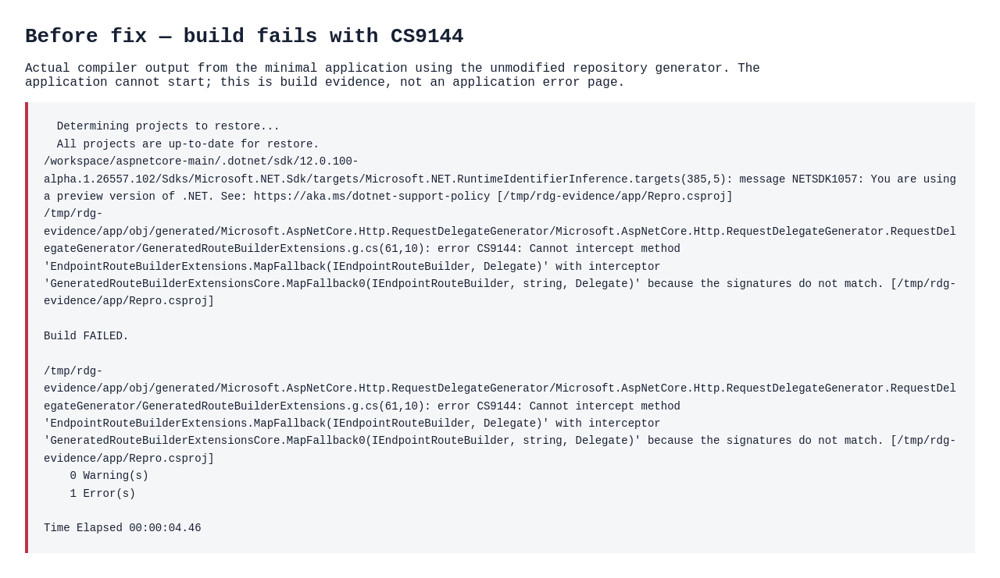
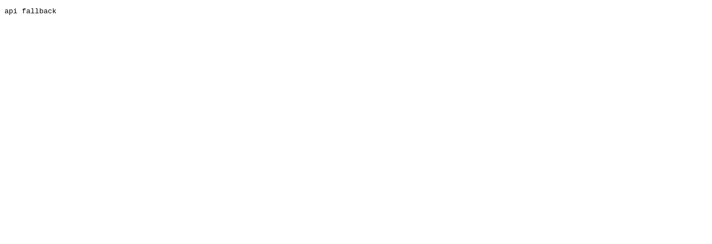

# Issue #69757: mixed MapFallback overloads

[Complete code patch, including regression coverage](fix.patch)

## Reproduction and root cause

The starting source is `origin/main` at `ae89581dfd24c6277b4267a9779d05f7b9f047f1`.
The minimal application registers:

```csharp
var builder = WebApplication.CreateBuilder(args);
var app = builder.Build();
app.MapFallback("/api/{*path}", () => "api fallback");
app.MapFallback(() => "site fallback");
app.Run();
```

`Endpoint.SignatureEquals` groups endpoints by the Map method name, response type,
and handler parameters. Both calls match those criteria, but the emitter also
uses `Operation.Arguments.Length` to determine whether an interceptor takes a
route-pattern argument. The group representative therefore produces an
interceptor with the wrong signature for the other overload, causing CS9144.
Reversing the calls changes which overload is incompatible.

The fix includes the invocation argument count in both signature equality and
its hash code. Pattern values remain outside the key, allowing compatible calls
with different patterns to continue sharing generated code. No public API changes
are needed.

History inspected: #67562 (`0977f169fd`) fixed pattern forwarding, while #67591
(`78b827ca96`) expanded handler-parameter comparison. Neither distinguished these
two overload shapes.

## Acceptance criteria

- Both declaration orders compile with RDG enabled.
- Matching string-returning and IResult-returning handlers are covered.
- Both endpoints retain their intended route patterns.
- Each endpoint returns its own handler's response.
- Compatible same-overload calls still share an interceptor.
- A real hosted application routes browser requests to the correct fallback.

## Evidence interpretation

This is a compiler failure, not a browser-rendering defect. Before the fix, the
application cannot start. The before screenshot shows actual compiler output
rendered in Chromium, not a simulated application error page. The after screenshots
capture the hosted application's actual plain-text responses.

## Validation performed

The repository-pinned SDK `12.0.100-alpha.1.26557.102` was installed and activated.
The initial focused repository build stopped on missing generated Blazor JavaScript
assets. The HTTP-only validation then used the supported `BuildNodeJS=false` setting
and explicitly built the assets project's `Build` target to create its static-web-assets
manifest. `UseIisNativeAssets=false` excluded unrelated native IIS prerequisites.
No build configuration, dependency manifests, or generated JavaScript were changed.

The permanent test is
`RequestDelegateCreation_SupportsMapFallback_MixedOverloads` in
`RequestDelegateCreationTests.cs`, inherited by both `CompileTimeCreationTests`
and `RuntimeCreationTests`. It runs the real generator, emits and loads the result,
checks generated-code metadata, verifies both route patterns, and invokes both
request delegates to assert their response bodies.

### Identical-test red/green results

| First registration | Handler return | Original RDG | Fixed RDG | Runtime delegate creation, before and after |
| --- | --- | --- | --- | --- |
| Explicit pattern | string | CS9144 | Pass | Pass |
| Explicit pattern | IResult | CS9144 | Pass | Pass |
| Default pattern | string | CS9144 | Pass | Pass |
| Default pattern | IResult | CS9144 | Pass | Pass |

Every failing row was inspected individually for CS9144. The final test assertions
were identical in the red and green runs. The wider fallback filter
`FullyQualifiedName~RequestDelegateCreation_SupportsMapFallback` passed **14/14**
tests, including the existing single-overload and supplied-pattern coverage.

The broader generator filter
`FullyQualifiedName~Microsoft.AspNetCore.Http.Generators.Tests` then passed
**1,690/1,690 tests**, with **zero failures and zero skips**, in 3 minutes 29 seconds.
That run used `--no-build --no-restore` against the just-built test assembly.
This was the generator test subset, not the entire HTTP Extensions or repository suite.

The test command used the existing
`src/Http/Http.Extensions/test/Microsoft.AspNetCore.Http.Extensions.Tests.csproj`
with `--no-restore -p:BuildNodeJS=false -p:UseIisNativeAssets=false` and console
verbosity `normal`. No tests were skipped by conditional setup in this focused run.

### Hosted application and browser

The minimal application above was built twice with the repository-built analyzer:
first unmodified, then patched, without changing application source. The SDK's
bundled RDG was disabled and the repository analyzer was explicitly added after
SDK analyzer filtering. This avoids accidentally validating a different generator
or falling back to runtime delegate creation. Generated source was inspected.

- Before: build exit code 1, CS9144, no running application.
- After: build exit code 0, zero warnings and zero errors.
- Chromium/Playwright: `GET /api/missing` returned HTTP 200 and `api fallback`.
- Chromium/Playwright: `GET /missing` returned HTTP 200 and `site fallback`.
- Chromium/Playwright: `GET /missing.txt` returned HTTP 404, preserving `nonfile`.
- A separate compile-only control with two calls to each overload built successfully
  and generated exactly two interceptor methods, `MapFallback0` and `MapFallback1`.
  Compatible calls therefore still share an interceptor even with different patterns.

### Scope and exclusions

This patch addresses the incompatible interceptor signatures in #69757. Native AOT
publishing and servicing-branch backports were not exercised.

An exploratory fallback-order assertion exposed a separate pre-existing difference:
RDG assigns order 0, whereas runtime delegate creation assigns `int.MaxValue`.
A separate single-overload application using the unmodified generator confirmed
`pattern={*path:nonfile}; Order=0`, so this does not depend on mixed-overload grouping.
Priority parity with other endpoints is explicitly excluded from this fix; no order
assertion is retained in the scoped regression. Blazor JavaScript behavior is also
outside the validation boundary.

## Browser screenshots

### Before: actual build output, rendered in Chromium



### After: actual response to GET /api/missing



### After: actual response to GET /missing


